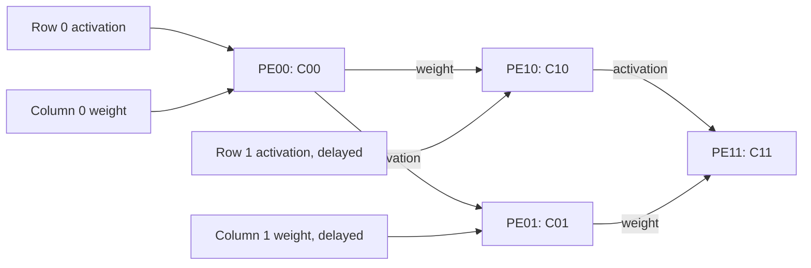

# DeltaTile — Tiny Tapeout INT4 accelerator

**DeltaTile** is a 2×2 signed INT4 systolic accelerator that retains four scores and updates them from changes in input features.

Status: RTL tests, gate-level tests, the one-tile physical build, strict signoff metrics, and the official IHP26b precheck pass for implementation revision `72cf3db7bd78a53d63e1f8e8d39cbff5dc5a253c`. Fabrication submission/payment and physical silicon validation remain outstanding. Power and application accuracy have not been measured.

The completed [v0.1.0 design release](https://github.com/Rithvik-Vadlamani/ttihp-deltatile/releases/tag/v0.1.0) contains the verified manufacturing files, exact source, datasheet, and verification evidence. The release is public and can be downloaded without an invitation. See the [submission record](docs/submission.md) for the exact revision and package identity. Purchases and fabrication orders are excluded from the current task at the owner's request.

- [Design proposal and tapeout milestones](docs/deltatile-proposal.md)
- [Executable arithmetic model](model/delta_reference.py)
- [Chip interface and bring-up vectors](docs/info.md)
- [RTL](src/project.v) and [pin-level tests](test/test.py)
- [Physical board bring-up](docs/bringup.md)
- [Signoff results and remaining submission steps](docs/signoff.md)

Run the model checks with `python3 model/delta_reference.py` from this directory. These checks validate arithmetic and workload counts, not clock-level behavior or silicon feasibility.

For RTL simulation, install `test/requirements.txt` in a virtual environment, then run `make` in `test/`. The simulator checkout and virtual environment must be in paths without spaces. The same tests run on the gate-level netlist in the official IHP26b GDS workflow. The clock target is 10 MHz.

For a workspace path containing spaces, run `python3 scripts/run_local_tests.py --venv /path/without/spaces/venv`. This copies the sources to a temporary build directory and preserves the result XML and waveform in `artifacts/local-tests/`.

`host/deltatile.py` plans dense/incremental frames, splits large corrections, checks readback, and accepts a caller-provided bus transport. Host packet plans are exercised against the chip by the fifth Cocotb test.

The five chip tests cover every signed 4-bit multiplier input pair, 400 incremental matrix transitions, 15,000 randomized protocol cycles, abort/reset/hold/error behavior, and 200 host-planned frames. Run the additional 13 host validation tests with `python -m pytest -q test/test_host.py`.

## Architecture

The array keeps four scores; the host owns feature history and weights. CLEAR initializes a dense computation, while subsequent tokens can apply exact corrections without clearing. A token uses two bus clocks; its final product completes two clocks after launch. Readback takes eight bytes.

## Synthetic traffic experiment

Run `python3 scripts/benchmark.py` to reproduce [the traffic results](docs/synthetic-traffic.json). For 2x16 bounded INT4 random-walk features with a 5% change-attempt probability per feature per frame, the measured software packet count is 13.1075 command clocks per frame versus 43 for dense refresh (3.28x fewer command clocks). This includes clear when needed, two drain clocks, and eight readback clocks. It excludes host computation, acquisition, electrical bus delays, and power; it is not a silicon performance or classification-accuracy result.

Template provenance: TinyTapeout/ttihp-verilog-template at `6598bef4d3159f19fe471a2a2225df52e6f5ad25`. The original template license is retained in LICENSE. RTL is original to this project.
